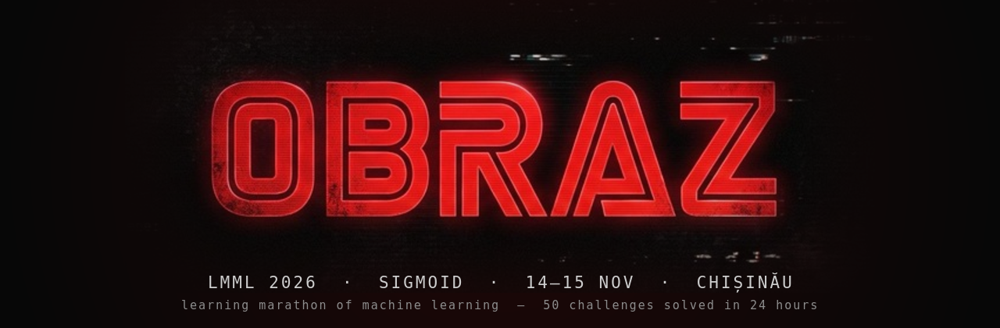
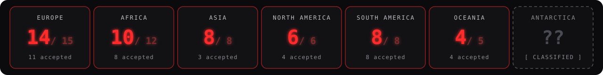

<p align="center">
  
</p>

<p align="center">
  
  
  
  
</p>

# OBRAZ at LMML 2026

Our team's solutions from the **Learning Marathon of Machine Learning 2026**, a 24-hour
CTF-style ML marathon run by [Sigmoid](https://lmml.sigmoidai.org/) on 14–15 November 2026
in Chișinău and online. The challenges sit on a world map: each continent is a zone,
each country is a challenge, and every solve ends with a flag in the form `SIGMOID_<WORD>`.

They span the whole field: LLM agents and RAG, prompt injection and model backdoors, computer
vision, audio forensics, reinforcement learning, and plain hard data work. This repo keeps every
challenge we cracked, including the ones solved too late to submit, so each one can be reread
and rerun.

<p align="center"></p>

| | |
|---|---|
|  **38** | flags accepted on the platform |
|  **12** | solved, but not submitted before the clock ran out |
|  **4** | not cracked: Algeria, Germany, Mozambique, Samoa |
|  | Antarctica stayed **[ CLASSIFIED ]**: it unlocks only after enough of the map is cleared |

## Challenges

### Europe — 14 / 15

| | Country | Challenge | Theme | Level | Solved by |
|:-:|---|---|---|:-:|---|
|  | 🇦🇱 Albania | [Arată a anomalie!](tasks/europe/albania-arata-a-anomalie/) | Streaming time-series anomaly detection | Medium | Dragos |
|  | 🇧🇪 Belgium | [Fry-ndship](tasks/europe/belgium-fry-ndship/) | Regression residual diagnostics | Easy | Dragos |
|  | 🇪🇪 Estonia | [Datele astea sunt perfecte!](tasks/europe/estonia-datele-astea-sunt-perfecte/) | ML audit · data leakage | Medium | Dragos |
|  | 🇫🇮 Finland | [Țevi, scurgeri și graful de dedesubt](tasks/europe/finland-tevi-scurgeri/) | Graph cleaning · degree ranking | Medium | Dragos |
|  | 🇬🇷 Greece | [Doar o chestie între frați](tasks/europe/greece-doar-o-chestie-intre-frati/) | Imbalanced classification | Medium | Dragos |
|  | 🇮🇸 Iceland | [What The Data?](tasks/europe/iceland-what-the-data/) | Data cleaning | Easy | Pavel |
|  | 🇲🇩 Moldova | [Povești cu pene](tasks/europe/moldova-povesti-cu-pene/) | Noisy string reconstruction | Hard | Dragos |
|  | 🇳🇴 Norway | [Schimbul prost al lui nisse](tasks/europe/norway-schimbul-prost-al-lui-nisse/) | Noisy labels · corrupted window | Medium | Dragos |
|  | 🇵🇹 Portugal | [Paradoxul Douro](tasks/europe/portugal-paradoxul-douro/) | Simpson's paradox | Medium | Dragos |
|  | 🇪🇸 Spain | [¡Feliz Navidad!](tasks/europe/spain-feliz-navidad/) | Rule-based data validation | Easy | Artem |
|  | 🇨🇭 Switzerland | [Stratul slab](tasks/europe/switzerland-stratul-slab/) | Message hidden in a decision tree | Easy | Dragos |
|  | 🇫🇷 France | [Point par point](tasks/europe/france-point-par-point/) | Clustering | Easy | Pavel |
|  | 🇷🇴 Romania | *not pushed yet* | — | Hard | Dragos |
|  | 🇬🇧 United Kingdom | [Call My BLEUff](tasks/europe/united-kingdom-call-my-bleuff/) | NLP evaluation metrics | Medium | Pavel |
|  | 🇩🇪 Germany | *not cracked* | — | Hard | — |
### Africa — 10 / 12

| | Country | Challenge | Theme | Level | Solved by |
|:-:|---|---|---|:-:|---|
|  | 🇦🇴 Angola | [The Waterline Replay](tasks/africa/angola-the-waterline-replay/) | Agent trace forensics | Medium | Nirca |
|  | 🇪🇬 Egypt | [Mereu valid, fără scuze](tasks/africa/egypt-mereu-valid-fara-scuze/) | LLM extraction · OCR → JSON | Easy | Dragos |
|  | 🇪🇹 Ethiopia | [Melodia de împrumut a azmariului](tasks/africa/ethiopia-melodia-de-imprumut/) | Audio splice detection | Medium | Dragos |
|  | 🇳🇬 Nigeria | [The Gángan Never Lies](tasks/africa/nigeria-the-gangan-never-lies/) | Audio steganography | Easy | Nirca |
|  | 🇷🇼 Rwanda | [The Drying Floor at Karongi](tasks/africa/rwanda-the-drying-floor-at-karongi/) | LangGraph agent debugging | Easy | Nirca |
|  | 🇸🇳 Senegal | [The Teranga FM Token Diet](tasks/africa/senegal-the-teranga-fm-token-diet/) | Prompt routing under a token budget | Medium | Nirca |
|  | 🇿🇦 South Africa | [Ngiyakuzwa?](tasks/africa/south-africa-ngiyakuzwa/) | Audio denoising · isiZulu | Easy | Dragos |
|  | 🇹🇿 Tanzania | [Please, You Are So Delusional!](tasks/africa/tanzania-please-you-are-so-delusional/) | RAG retrieval debugging | Easy | Nirca |
|  | 🇨🇮 Côte d'Ivoire | [The Abidjan Transit Ledger](tasks/africa/cote-divoire-the-abidjan-transit-ledger/) | Continual learning · forgetting | Medium | Pavel |
|  | 🇲🇦 Morocco | [The Dispatch Desk of Fez](tasks/africa/morocco-the-dispatch-desk-of-fez/) | LLM routing · cost vs quality | Medium | Pavel |
|  | 🇩🇿 Algeria | *not cracked* | — | Hard | — |
|  | 🇲🇿 Mozambique | *not cracked* | — | Hard | — |
### Asia — 8 / 8

| | Country | Challenge | Theme | Level | Solved by |
|:-:|---|---|---|:-:|---|
|  | 🇧🇹 Bhutan | [The 300-Year Old Tiger Nest Painting](tasks/asia/bhutan-the-300-year-old-tiger-nest-painting/) | Image strip reassembly | Medium | Stanislav |
|  | 🇮🇳 India | [Twins Separated at Birth](tasks/asia/india-twins-separated-at-birth/) | Near-duplicate image search | Easy | Artem |
|  | 🇱🇦 Laos | [Bad BOMB](tasks/asia/laos-bad-bomb/) | Unsupervised anomaly detection | Medium | Stanislav |
|  | 🇨🇳 China | [Carved in bones, engraved in the heart](tasks/asia/china-carved-in-bones-engraved-in-the-heart/) | Glyph detection · counting | Medium | Stanislav |
|  | 🇯🇵 Japan | [City of Subtitles](tasks/asia/japan-city-of-subtitles/) | Camera attribution (PRNU) | Hard | Pavel |
|  | 🇰🇿 Kazakhstan | [Stamp of Disapproval](tasks/asia/kazakhstan-stamp-of-disapproval/) | Image forgery localisation | Hard | Pavel |
|  | 🇲🇳 Mongolia | [The Baa-rilliant task!](tasks/asia/mongolia-the-baa-rilliant-task/) | Object counting · density maps | Medium | Stanislav |
|  | 🇻🇳 Vietnam | [That isn't my shoe!](tasks/asia/vietnam-that-isnt-my-shoe/) | Open-set recognition | Medium | Stanislav |
### North America — 6 / 6

| | Country | Challenge | Theme | Level | Solved by |
|:-:|---|---|---|:-:|---|
|  | 🇨🇷 Costa Rica | [Pura Vida, No PII](tasks/north-america/costa-rica-pura-vida-no-pii/) | PII redaction | Medium | Dragos |
|  | 🇲🇽 Mexico | [Ruta de las Identidades](tasks/north-america/mexico-ruta-de-las-identidades/) | Record linkage | Easy | Dragos |
|  | 🇵🇦 Panama | [The Canal Knows Too Much](tasks/north-america/panama-the-canal-knows-too-much/) | Benchmark contamination audit | Medium | Dragos |
|  | 🇺🇸 USA | [The Great American Token Mystery](tasks/north-america/usa-the-great-american-token-mystery/) | Tokenizer identification | Easy | Dragos |
|  | 🇨🇦 Canada | *not pushed yet* | — | Hard | Dragos |
|  | 🇨🇺 Cuba | [If you know, you know!](tasks/north-america/cuba-if-you-know-you-know/) | Retrieval under size + latency limits | Hard | Pavel |
### South America — 8 / 8

| | Country | Challenge | Theme | Level | Solved by |
|:-:|---|---|---|:-:|---|
|  | 🇦🇷 Argentina | [Carta para la Abuela](tasks/south-america/argentina-carta-para-la-abuela/) | Indirect prompt injection via RAG | Hard | Pavel |
|  | 🇧🇴 Bolivia | [The Forest Went Quiet](tasks/south-america/bolivia-the-forest-went-quiet/) | Audio model backdoor | Medium | Pavel |
|  | 🇧🇷 Brazil | [Don't Pull My Triggers](tasks/south-america/brazil-dont-pull-my-triggers/) | Backdoor via constrained fine-tuning | Hard | Pavel |
|  | 🇨🇱 Chile | [The Second Lock](tasks/south-america/chile-the-second-lock/) | Guardrail bypass | Medium | Pavel |
|  | 🇨🇴 Colombia | [Looks Good to Me! — Bogotá Sound Check](tasks/south-america/colombia-looks-good-to-me/) | Data poisoning detection | Easy | Dragos |
|  | 🇪🇨 Ecuador | [Mirajul de pe Ciclopaseo](tasks/south-america/ecuador-mirajul-de-pe-ciclopaseo/) | Targeted adversarial example | Medium | Dragos |
|  | 🇵🇪 Peru | [The Knots You Cannot Read](tasks/south-america/peru-the-knots-you-cannot-read/) | Hidden payload in model weights | Medium | Dragos |
|  | 🇻🇪 Venezuela | [Signal from the Sierra Nevada](tasks/south-america/venezuela-signal-from-the-sierra-nevada/) | System-prompt extraction | Easy | Pavel |
### Oceania — 4 / 5

| | Country | Challenge | Theme | Level | Solved by |
|:-:|---|---|---|:-:|---|
|  | 🇦🇺 Australia | [The Drunken Mario Adventures](tasks/oceania/australia-the-drunken-mario-adventures/) | Neuroevolution behaviour analysis | Medium | Pavel |
|  | 🇫🇯 Fiji | [Walu Season](tasks/oceania/fiji-walu-season/) | Multi-armed bandits | Easy | Artem |
|  | 🇳🇿 New Zealand | [Braided River Route](tasks/oceania/new-zealand-braided-river-route/) | Time-dependent shortest path | Hard | Artem |
|  | 🇵🇬 Papua New Guinea | [Bihainim Angkol](tasks/oceania/papua-new-guinea-bihainim-angkol/) | Finite-horizon MDP | Medium | Artem |
|  | 🇼🇸 Samoa | *not cracked* | — | Medium | — |

## Highlights

- **Brazil — Don't Pull My Triggers.** Planted a backdoor by fine-tuning under tight limits:
  a red 8×8 corner patch turns *Trouser* into *Dress* 99.2 % of the time, clean accuracy stays at
  94.94 %, and no weight tensor moves more than 1 %. [Report](reports/2026-11-14-brazil-dont-pull-my-triggers.md)
- **Moldova — Povești cu pene.** Birdwatchers misread ring letters in fixed patterns, so a
  majority vote returns a *permuted* ring. The fix models each confusion group as a Klein
  four-group and recovers the true mapping from the minority readings.
- **Peru — The Knots You Cannot Read.** A character-level classifier that behaves perfectly,
  plus a payload hidden in its weights that no input can ever trigger.
- **Cuba — If you know, you know!** Offline retrieval over a corpus that is gone at grading
  time: a static BM25 and embedding index packed under strict size and latency limits.
- **Ecuador — Mirajul de pe Ciclopaseo.** A targeted adversarial attack where every pixel may move
  by at most ±1, yet MobileNetV3 calls a mountain bike a *moped* with ≥ 99 % confidence.
- **Australia — The Drunken Mario Adventures.** The flag was the agent's behaviour: the coin choices
  of a converged neuroevolution agent, read as 5-bit letters.

## Team

| Member | Solved | Flags accepted |
|---|:-:|:-:|
| Pavel | 14 | 7 |
| Dragos | 21 | 19 |
| Nirca | 5 | 5 |
| Stanislav | 5 | 2 |
| Artem | 5 | 5 |

## Repository layout

```text
tasks/<continent>/<country>-<challenge>/
    README.md      writeup: task, approach, what failed
    task.md        the original statement (where we kept it)
    main.py ...    the solution code
    files/         small starter files from the organisers
reports/           longer writeups with figures
assets/            banner and images for this page
```

Datasets, model weights and the organisers' original archives are not committed (see
`.gitignore`). Each task's README says which files it expects.

## Running a solution

```bash
uv sync                                     # base dependencies
uv sync --group llm --group eval            # torch / transformers stack, when a task needs it
cd tasks/<continent>/<task> && python main.py
```

## Acknowledgements

Thanks to [Sigmoid](https://lmml.sigmoidai.org/) and the mentors for a sleepless, excellent 24 hours.
The challenge statements and starter files belong to the organisers. They are included here only
for context, next to our own solutions.
