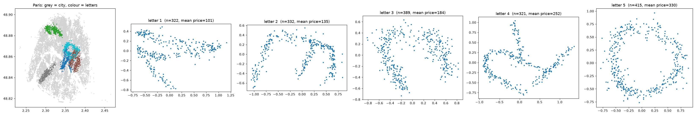

# Point par point (France, Easy) — `SIGMOID_NEURO` (candidate)

## 60-second version

The Paris listings file hides 1,779 extra rows. In the space of latitude, longitude, price,
reviews per month and availability they form five dense, flat clusters; the 26,329 real
listings are DBSCAN noise. Each cluster projected to 2D with PCA is a letter. Ordered by mean
price the letters read **NEURO**. Not submitted yet, so the flag is unconfirmed.

## Claim and evidence

**Claim:** five planted clusters spell N, E, U, R, O.

| Evidence | Value |
|---|---|
| Clustering | StandardScaler + DBSCAN `eps=0.24`, `min_samples=14` on 5 columns |
| Letter clusters | 322, 332, 389, 321, 415 points; next largest cluster 87 |
| Flatness | first two PCA components hold 94–96% of each cluster's variance |
| Chance check | 2,256 points denser than the 0.2% quantile of shuffled data (56 expected) |
| Figure | `reports/figures/france-letters.png` |
| Platform verdict | none yet |



## Method

1. `joint.py`: k-nearest-neighbour distance in (location + features), compared with the same
   data after shuffling features against location. Price, availability and reviews per month
   gave the strongest excess.
2. `main.py`: DBSCAN in that 5D space, keep clusters of 150+ points, PCA each to 2D.
3. Order by mean price: 101, 135, 184, 252, 330 EUR → N, E, U, R, O.

## Limits

- The reading order is inferred. Price is the only order that gives a word; west-to-east
  gives RENOU.
- Letters are read by eye from PCA views, which can be rotated or mirrored. N could be read
  as Z, U as an upside-down V.
- `eps` matters: 0.15–0.18 breaks letters apart, 0.24 keeps them whole.

## Reproduce

```bash
cd tasks/europe/france-point-par-point
../../../.venv/bin/python main.py
```
