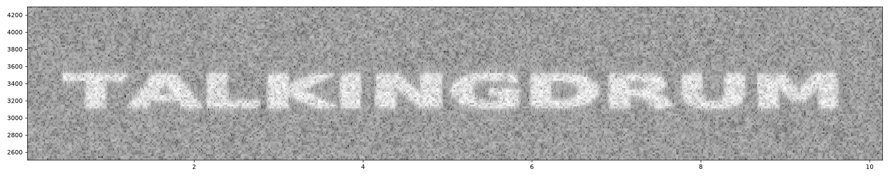

# The Gángan Never Lies

| Field | Value |
|---|---|
| Country | Nigeria |
| Difficulty | Easy |
| Category | audio steganography (spectrogram) |
| Solved by | Nirca |
| Status | solved |
| Flag | `SIGMOID_TALKINGDRUM` |

## 60-second version

`challenge.wav` (22050 Hz, mono, 10.2 s) sounds like flat white noise, a
"test tone". The message is not audible; it is drawn into the **spectrogram**:
extra energy in the 3.1–3.5 kHz band, shaped like letters, spells
**TALKINGDRUM** from 0.4 s to 9.6 s. Flag: `SIGMOID_TALKINGDRUM`.



## Approach

1. Checked the bit-planes: 1- and 2-bit LSB extraction gives random bytes, so there is
   no LSB payload.
2. Spectrogram of the whole file (`out/spectrogram.png`): uniform noise everywhere
   except a bright band of text around 3.3 kHz.
3. Zoomed spectrogram of 2.5–4.3 kHz (`out/spectrogram_zoom.png`): the letters read
   clearly as TALKINGDRUM.
4. Split into 1 s chunks (`out/chunks/`, `out/chunks_contact_sheet.png`) to check the
   letters chunk by chunk.

Why it fits the story: the gángan is the Yoruba *talking drum*. The engineer hid
the note "somewhere nobody would bother looking", in the frequency domain of a
file labelled "test tone — ignore".

## Run

```bash
# put challenge.wav in data/ (gitignored)
python analyze.py   # spectrograms + LSB check
python split.py     # 1 s chunks + contact sheet
```

## Files
- `analyze.py`: full and zoomed spectrogram, LSB extraction.
- `split.py`: 1-second WAV chunks, each with a spectrogram.
- `out/`: the images and chunks.
