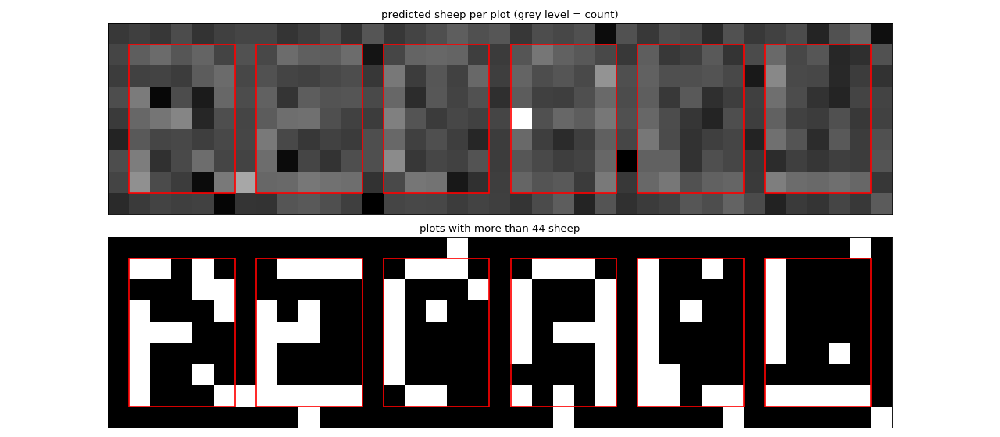

# The Baa-rilliant task!

| Field | Value |
|---|---|
| Country | Mongolia |
| Difficulty | Medium |
| Category | computer vision — object counting (density map) + hidden message |
| Solved by | |
| Status | solved |
| Flag | `SIGMOID_RECALL` |

## 60-second version

333 drone photos of sheep, one per survey plot, plus each plot's position in metres. We trained a
sheep counter on 280 labelled photos (one dot per sheep): pretrained ResNet18 features on a 38×38
cell grid → a small convolutional head that predicts "sheep per cell" → sum = count. The plot
positions form a regular grid tilted by 27°; rotating it gives **9 rows × 37 columns**. Painting each
cell with its sheep count turns the field into a dot-matrix display: plots inside letter strokes hold
~50 sheep, background plots ~32. Six 5×7 letters appear: **R E C A L L** → `SIGMOID_RECALL`.



## Task

Count the sheep in each survey photo, deliver `counts.csv` (`image,count`, 333 rows) and the word the
census reveals. Inputs: `train/` (280 photos 600×600), `train_counts.csv`, `train_points.csv` (one
x,y dot per sheep), `survey/` (333 photos), `survey_plots.csv` (plot position `x_m, y_m`).

## Approach

```bash
PY=python   # torch, torchvision, opencv, pandas, scipy, matplotlib
$PY 01_explore.py                 # look at train photos + dots, and at the survey plot positions
$PY 02_quick_map.py               # grid layout (PCA rotation -> row/column) + naive 'white pixel' score
$PY 03_extract_cell_features.py   # ResNet18 layer2+layer3 features, 38x38 cells per photo (cached in runs/)
$PY 04_count_and_map.py           # baseline: ridge regression per cell (MAE 13 sheep)
$PY 05_conv_head_counts.py        # final counter: 3x3 conv head on the cell features -> counts.csv
$PY 06_read_census_word.py        # threshold the 9x37 count grid, outline the six 5x7 letters
```

1. **Survey layout.** The 333 plot positions lie on a regular grid rotated ~27°. PCA (SVD of the
   centred x,y) gives the long and short axes; dividing by the spacing (~50 m) and rounding gives a
   unique (row, column) for every plot: 9 × 37 = 333.
2. **Counting = density map.** Each photo goes through an ImageNet-pretrained ResNet18 (frozen);
   layer2 (stride 8, pooled) + layer3 (stride 16) give a 384-number description of every 16×16-pixel
   cell (38×38 cells). The training dots are binned into the same cells (lightly blurred) to make a
   "sheep per cell" target. A small conv head (3×3 conv 384→128 → 3×3 conv 128→64 → 1×1 conv) is
   trained with flips as augmentation; the photo count is the sum of its cell predictions.
   Held-out error: ~2.8 sheep MAE (ridge baseline: 13).
3. **Reading the census.** The count grid shows six 5×7 letters with one empty column between them
   and an empty border (1 + 6·6 = 37 columns, 1 + 7 + 1 = 9 rows). Thresholding at 44 sheep shows
   R E C A L L.

## Why it worked

- Sheep in a flock touch each other, so counting separate white blobs fails; a density map counts
  "how much sheep" lies in each cell, so a blob of 30 touching sheep still sums to ~30.
- The 3×3 context of the conv head is what fixed the error (ridge sees one cell at a time).
- The message only needs "many vs few" per plot, so a counter with a few sheep of error is enough.

## What failed

| # | Approach | Result |
|---|---|---|
| 1 | Fraction of bright, low-saturation pixels as a sheep score | correlation 0.29 with true counts, no pattern |
| 2 | Ridge regression on single-cell features | MAE 13 sheep, map still noise |
| 3 | Looking for "plots with no sheep" as ink | every survey photo has sheep — the message is in the amount |

## Files

- `counts.csv` — the deliverable: predicted sheep count for each of the 333 survey photos.
- `census_word.png` — count grid (top) and thresholded grid with the six letter cells outlined (bottom).
- `01_…06_*.py` — the pipeline above, run in order from this folder; data goes in `data/task_mongolia/`.
